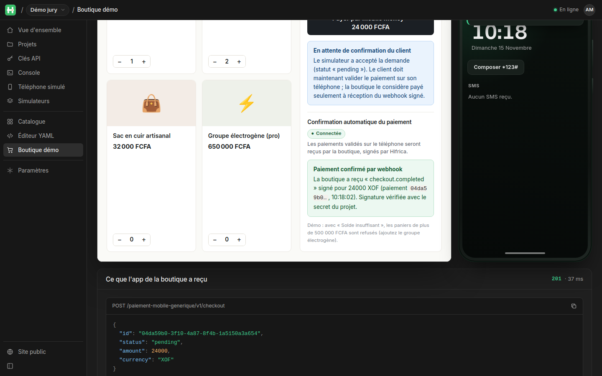
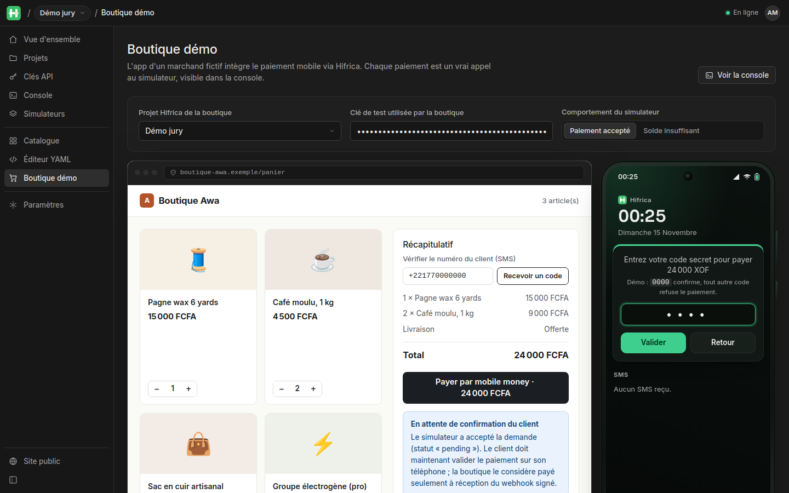
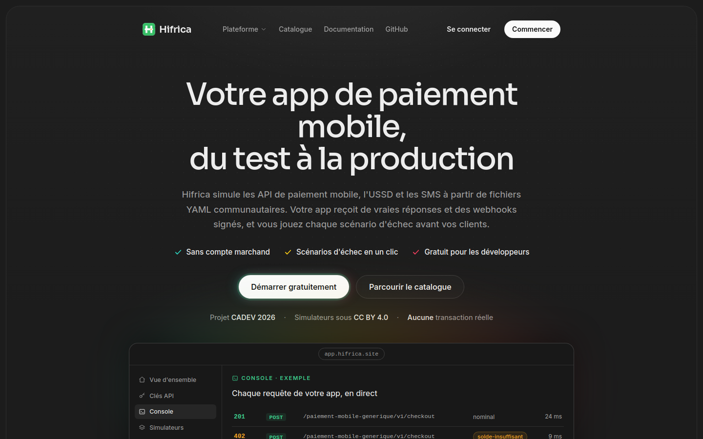
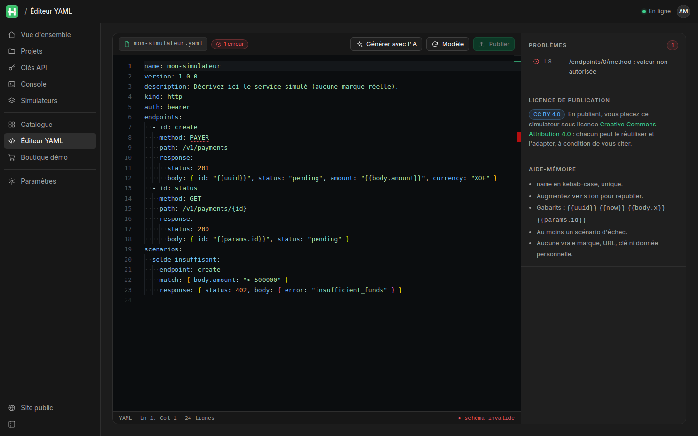
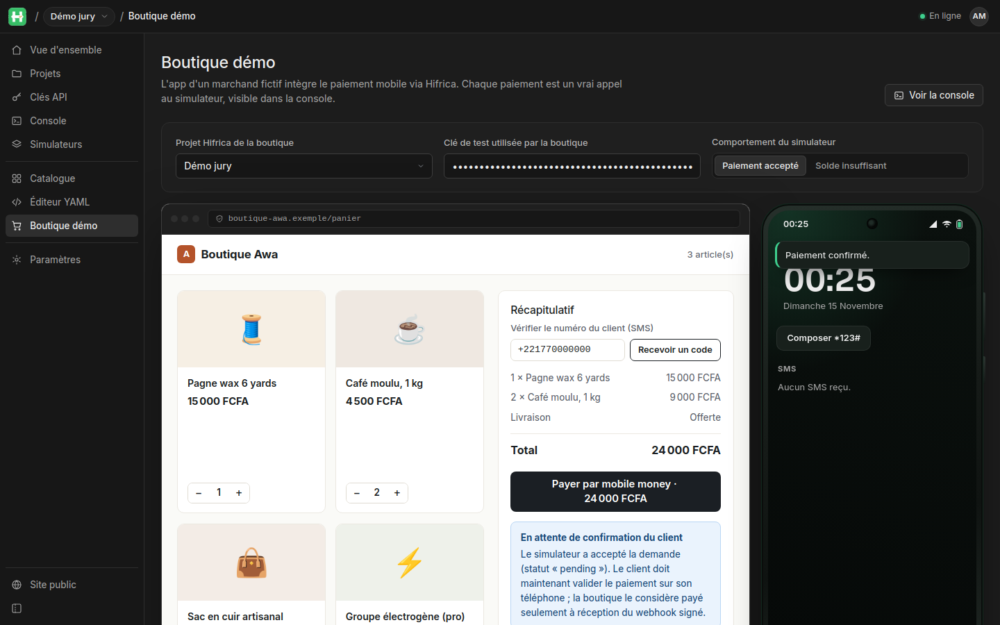
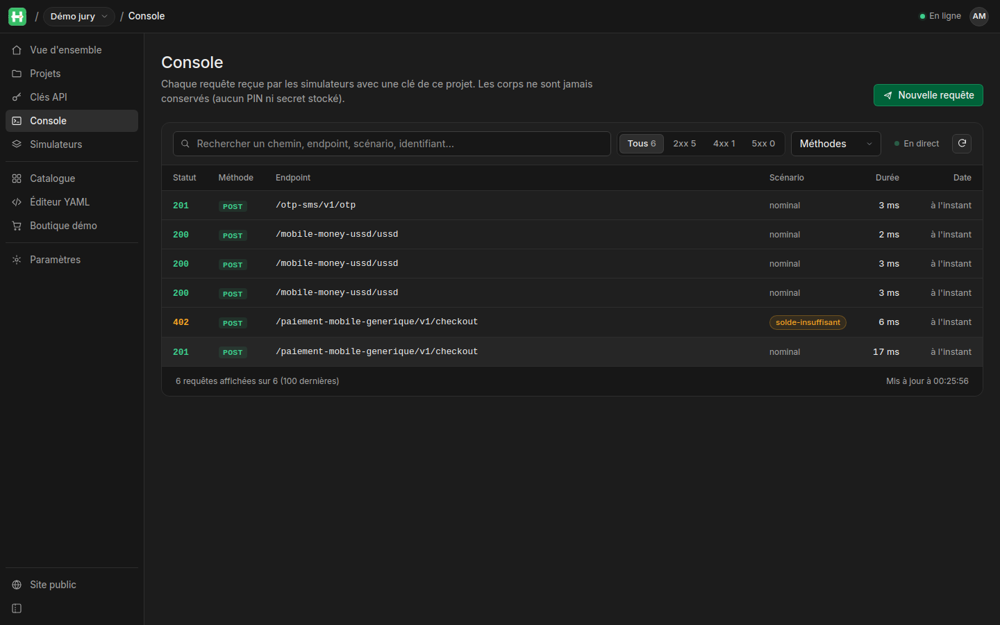
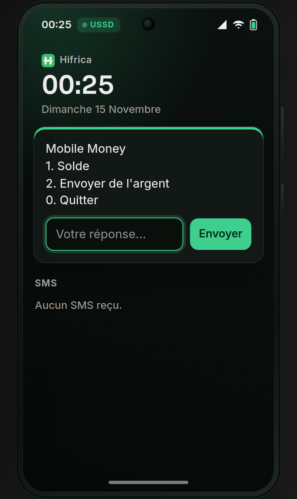
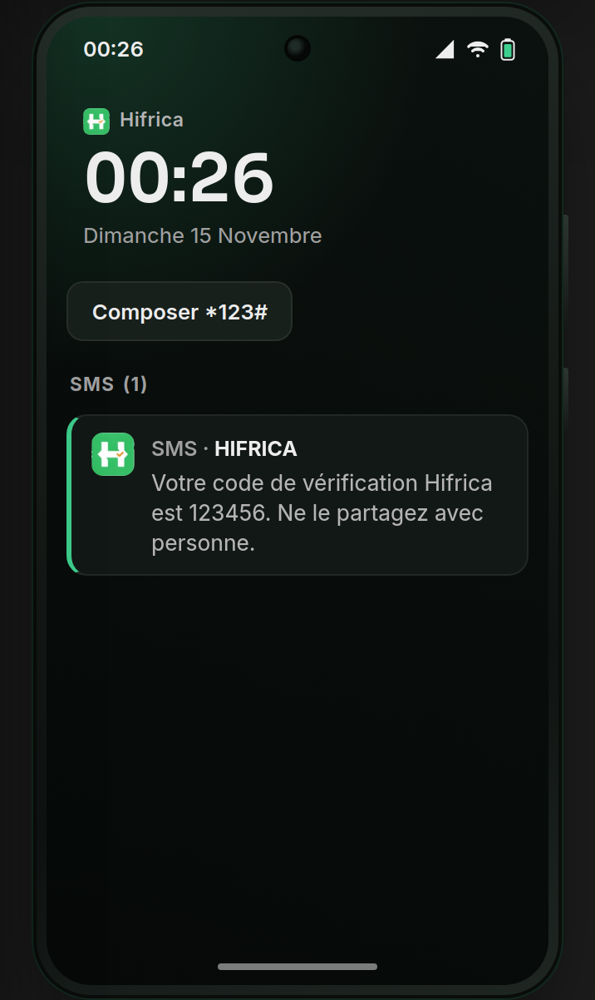

# Hifrica

Hifrica est une plateforme ouverte de simulateurs de paiement mobile, d'USSD et de SMS, faite par des développeurs africains pour des développeurs africains : on teste son app sans compte marchand, sans argent réel et sans attendre un accès « sandbox ».
Chaque simulateur est un fichier YAML lisible, que l'on peut partager, forker et améliorer.
Un assistant IA écrit un premier simulateur à partir d'une simple description en français.

Projet présenté au concours CADEV 2026.

- **Application** : https://app.hifrica.site
- **Simulateurs** : https://sim.hifrica.site (pour les programmes ; ouvert dans un navigateur, renvoie au catalogue)

> **État du projet.** Fonctionnent en ligne : le moteur HTTP et ses scénarios d'échec, les comptes, projets et clés, la console, le catalogue, l'éditeur et le fork, l'exécution par le moteur des simulateurs publiés, le téléphone simulé (confirmation d'un paiement par code secret, SMS, menus USSD), les webhooks signés et leur réception par la boutique de démonstration, et l'assistant IA, qui dépend de la disponibilité de ses fournisseurs et des quotas décrits plus bas.

---

## Démarrage en 5 minutes

### 1. Compte, projet, clé

1. Sur https://app.hifrica.site, cliquez sur **Créer un compte** (email et mot de passe de 8 caractères au moins, ou GitHub si le serveur l'a activé).
2. Cliquez sur **Nouveau projet** (ou **Créer un projet** sur un compte neuf) et donnez-lui un nom.
3. Hifrica ouvre alors **Clés API** avec la fenêtre de création : cliquez sur **Créer la clé** (plus tard, **Nouvelle clé** ouvre la même fenêtre). La clé (`sk_test_` suivi de 43 caractères) s'affiche **une seule fois** : copiez-la tout de suite. Hifrica n'en garde que l'empreinte.

### 2. Appeler un simulateur

Remplacez `sk_test_VOTRE_CLE` par votre clé :

```bash
curl -i -X POST https://sim.hifrica.site/paiement-mobile-generique/v1/checkout \
  -H "Authorization: Bearer sk_test_VOTRE_CLE" \
  -H "Content-Type: application/json" \
  -d '{"amount": 5000, "merchant": "Boutique"}'
```

Réponse `201` : `{"id":"…","status":"pending","amount":5000,"currency":"XOF"}`, avec un en-tête `X-Hifrica-Request-Id` qui identifie l'appel.

Une clé qui n'a pas été créée dans Hifrica, ou qui a été révoquée, reçoit `401 {"error":"invalid_test_key"}`.

### 3. Déclencher un échec

Deux façons, au choix :

- **Pour un seul appel**, ajoutez l'en-tête `X-Hifrica-Scenario: solde-insuffisant` ;
- **Pour tous les appels du projet**, choisissez **solde-insuffisant** dans la page **Simulateurs** du projet.

Un scénario ne s'applique que si sa condition est remplie. Pour `solde-insuffisant`, il faut un montant supérieur à 500 000 :

```bash
curl -i -X POST https://sim.hifrica.site/paiement-mobile-generique/v1/checkout \
  -H "Authorization: Bearer sk_test_VOTRE_CLE" \
  -H "X-Hifrica-Scenario: solde-insuffisant" \
  -H "Content-Type: application/json" \
  -d '{"amount": 600000, "merchant": "Boutique"}'
# → 402 {"error":"insufficient_funds"}
```

L'en-tête l'emporte sur le scénario choisi dans **Simulateurs**. Sans l'un ni l'autre, le simulateur donne sa réponse normale.

### 4. Voir la requête dans la console

L'onglet **Console** du projet liste chaque appel : méthode, chemin, statut, durée, scénario appliqué. Le journal se rafraîchit toutes les 3 secondes tant que **En direct** est actif (un clic le met en pause). **Nouvelle requête** appelle un simulateur sans quitter le navigateur.

La page **Boutique démo** rejoue ce parcours dans une petite boutique en ligne : voir [5. La boutique de démonstration](#5-la-boutique-de-démonstration).

### 5. La boutique de démonstration

La page **Boutique démo** est la boutique d'un marchand fictif qui encaisse avec **votre** projet et **votre** clé de test. Chaque paiement est un vrai appel au moteur, visible dans la console.

1. Choisissez le projet et collez sa clé de test (une clé créée pendant la session est reprise automatiquement).
2. Composez le panier, puis cliquez sur **Payer par mobile money**. La boutique appelle `paiement-mobile-generique`, affiche la réponse reçue et passe « En attente de confirmation du client ».
3. Le **téléphone simulé**, à côté de la boutique, reçoit la demande. Cliquez sur **Confirmer**, saisissez le code secret `0000`, puis **Valider** : le téléphone affiche « Paiement confirmé. ». Tout autre code refuse le paiement. Le code n'est jamais envoyé au serveur.
4. Le message du téléphone ne vaut pas paiement pour la boutique : comme une vraie boutique, elle ne considère un paiement comme payé qu'à la réception du webhook signé `checkout.completed` (voir [Webhooks](#webhooks)). Dans la section « Confirmation automatique du paiement », sous le bouton de paiement, **Recevoir les webhooks dans la boutique** règle l'URL de webhook du projet sur la boutique : un seul clic si le projet n'a pas encore d'URL de webhook ; s'il en a déjà une, la page le signale et un second clic sur **Confirmer : remplacer l'URL de webhook** est demandé (**Annuler** pour garder l'URL actuelle, qui reste modifiable dans **Paramètres**). La section affiche alors le badge « **Connectée** ».
5. Une fois ce récepteur branché, la boutique affiche, quelques secondes après la validation sur le téléphone, « **Paiement confirmé par webhook** » : le webhook a été reçu et sa signature vérifiée avec le secret du projet. Sans récepteur, elle reste « En attente de confirmation du client ».

   
6. **Comportement du simulateur** choisit le scénario de tout le projet : avec **Solde insuffisant**, un panier de plus de 500 000 FCFA est refusé (`402`).
7. **Recevoir un code** envoie un code à usage unique au numéro saisi, via le simulateur `otp-sms` : le SMS arrive sur le téléphone.
8. Sur le téléphone, **Composer \*123#** ouvre le menu USSD du simulateur `mobile-money-ussd` (solde, envoi d'argent).



**Tester votre propre application.** Le téléphone simulé reçoit les paiements de toute application qui appelle un simulateur avec une clé du projet, pas seulement ceux de la boutique. Pour valider ceux de votre application, ouvrez la page **Téléphone simulé** du projet **avant** de lancer le paiement : les paiements créés avant l'ouverture du téléphone ne sont pas récupérés. Le webhook signé part ensuite vers l'URL configurée dans **Paramètres**, c'est-à-dire votre serveur.

---

## Parcours de démonstration (jury)

Environ 15 minutes sur https://app.hifrica.site, avec un navigateur récent. Aucun identifiant n'est fourni : on part d'un compte neuf.

1. **Créer un compte** : **Commencer** sur la page d'accueil (ou **Créer un compte**), puis un nom, un email et un mot de passe de 8 caractères au moins, et **Créer mon compte**.
2. **Créer un projet** : **Créer un projet** (ou **Nouveau projet** dans **Projets**), par exemple « Démo jury », puis **Créer le projet**. Hifrica ouvre ensuite la page **Clés API**.
3. **Créer une clé de test** : la fenêtre de création s'ouvre d'elle-même, cliquez sur **Créer la clé** (sinon : **Clés API**, puis **Nouvelle clé**). Copiez la clé `sk_test_…` : elle ne s'affiche qu'une fois. La boutique de démonstration la reprend automatiquement pendant la session.
4. *(Facultatif, dans un terminal)* **Appeler un simulateur** avec les commandes `curl` de [2. Appeler un simulateur](#2-appeler-un-simulateur) et [3. Déclencher un échec](#3-déclencher-un-échec) : réponse `201`, puis `402`.
5. **Brancher les webhooks** : **Boutique démo**, puis **Recevoir les webhooks dans la boutique**. Sur un projet neuf, sans URL de webhook, ce seul clic suffit. Si le projet a déjà une URL de webhook, un second clic sur **Confirmer : remplacer l'URL de webhook** la remplace. La section « Confirmation automatique du paiement » affiche alors le badge « **Connectée** ». Le téléphone simulé est affiché à côté de la boutique : gardez-le visible avant de payer.
6. **Payer dans la boutique** : **Payer par mobile money**. La boutique affiche « En attente de confirmation du client » et « En attente du webhook signé », et le téléphone simulé reçoit la demande.
7. **Confirmer sur le téléphone** : **Confirmer**, code `0000`, puis **Valider**. Deux confirmations distinctes apparaissent :
   - **sur le téléphone**, « Paiement confirmé. » pendant quelques secondes : c'est la réponse du client, pas encore la preuve du paiement pour la boutique ;
   - **dans la boutique**, quelques secondes plus tard, le cadre « **Paiement confirmé par webhook** », qui indique « Signature vérifiée avec le secret du projet » : c'est la confirmation effective, reçue par webhook signé.

   Pour voir un refus, refaites un paiement et saisissez un autre code : le téléphone affiche « Code incorrect : paiement refusé. », et aucune confirmation n'arrive dans la boutique.
8. **Déclencher un échec** : **Comportement du simulateur** sur **Solde insuffisant**, ajoutez le groupe électrogène (650 000 FCFA), puis **Payer par mobile money**. La boutique affiche « Paiement refusé : solde insuffisant ». Repassez sur **Paiement accepté**.
9. **USSD** : sur le téléphone, **Composer \*123#**, répondez `1` (Solde) puis **Envoyer**, saisissez un code à 4 chiffres puis **Envoyer** : « Votre solde est de 15 000 XOF. »
10. **SMS** : dans le récapitulatif de la boutique, gardez le numéro proposé et cliquez sur **Recevoir un code**. Le SMS arrive dans la boîte du téléphone.
11. **Voir chaque appel dans la console** : **Console**. Le checkout `201`, le refus `402` avec son scénario, les appels USSD et l'envoi du SMS y figurent, avec leur durée. Dans **Paramètres**, l'**historique des webhooks** montre l'envoi `checkout.completed` et son résultat (`Livré`).
12. **Catalogue et éditeur** : **Catalogue**, ouvrez `paiement-mobile-generique`, puis **Forker**. L'éditeur valide pendant la frappe : une erreur est soulignée sur sa ligne, et **Publier** reste grisé tant qu'elle n'est pas corrigée.
13. **Assistant IA** : suivez l'[exemple de l'assistant IA](#exemple--une-api-de-transfert-dargent) (génération, relecture, publication, appel avec votre clé).

### En images

| | |
| --- | --- |
|  |  |
|  |  |
|  |  |

---

## Écrire son simulateur

Un simulateur est un fichier YAML validé par un JSON Schema commun ([`packages/shared/src/schema.ts`](packages/shared/src/schema.ts)) : le même contrôle est fait dans l'éditeur, par l'API, par le moteur et sur la sortie de l'assistant IA. Taille maximale : 64 Ko.

**Publié, il répond tout de suite.** Un simulateur publié depuis l'éditeur est appelable sur `https://sim.hifrica.site/<slug>/…` (le `slug` est son `name`), avec une clé de test, comme ceux livrés avec la plateforme. C'est vrai aussi pour ceux marqués **« Généré par IA, à vérifier »** : relisez-les avant de vous y fier. Une nouvelle version est prise en compte au plus 30 secondes après sa publication, et un simulateur retiré du catalogue cesse de répondre dans le même délai. Si un simulateur livré avec la plateforme (dossier `simulators/`) porte le même nom, c'est lui qui répond. Un appel sans clé de test bien formée (`Bearer sk_test_` suivi de 43 caractères) reçoit `401 {"error":"invalid_test_key"}` avant toute recherche du simulateur ; ouverte dans un navigateur, l'adresse renvoie à la fiche du catalogue. Si la base ne répond pas, le moteur renvoie `503 {"error":"engine_unavailable"}` plutôt que de déclarer le simulateur inconnu.

### Simulateur HTTP

```yaml
name: paiement-qr-boutique          # identifiant : minuscules, chiffres et tirets
version: 1.0.0
description: Paiement par QR code (format neutre, aucune marque réelle).
kind: http
auth: bearer                        # l'app appelle avec Authorization: Bearer sk_test_...
endpoints:
  - id: checkout
    method: POST
    path: /v1/checkout
    response:
      status: 201
      # {{uuid}} : nouvel identifiant ; {{body.x}} : champ du corps reçu ; {{now}} : date ISO 8601
      body: { id: "{{uuid}}", status: "pending", amount: "{{body.amount}}", created_at: "{{now}}" }
    phone:                          # écran affiché sur le téléphone simulé de l'interface
      screen: confirm-payment
      text: "Payer {{body.amount}} FCFA à {{body.merchant}} ?"
    webhook:
      on: phone.confirm             # envoyé quand le client confirme sur le téléphone
      event: checkout.completed
      # {{response.id}} : le même id que celui renvoyé à l'app dans la réponse 201
      body: { id: "{{response.id}}", status: "succeeded", amount: "{{body.amount}}" }
  - id: status
    method: GET
    path: /v1/checkout/{id}         # {id} est lu avec {{params.id}}
    response:
      status: 200
      body: { id: "{{params.id}}", status: "pending", lang: "{{query.lang}}" }
  - id: refund
    method: POST
    path: /v1/checkout/{id}/refund
    response:
      status: 202
      body: { id: "{{params.id}}", status: "refund_pending" }
    webhook:                        # sans « on » : envoyé après la réponse, au bout de « after »
      after: 5s
      event: refund.completed
      body: { id: "{{params.id}}", status: "refunded" }
scenarios:
  solde-insuffisant:
    endpoint: checkout
    match: { body.amount: "> 500000" }   # opérateurs : > < >= <= != contains, ou égalité
    response: { status: 402, body: { error: "insufficient_funds" } }
  reseau-lent:
    endpoint: checkout
    delay: 10s                      # plafonné à 30 s
```

Les variables :

| Variable | Valeur |
| --- | --- |
| `{{body.x}}`, `{{query.x}}`, `{{params.x}}` | Champ du corps, de la query ou du chemin de la requête reçue |
| `{{response.x}}` | Champ de la réponse déjà renvoyée (dans le corps d'un webhook) |
| `{{uuid}}`, `{{now}}` | Nouvel identifiant, date et heure ISO 8601 (toujours du texte) |

Une valeur réduite à une seule variable garde son type : `amount: "{{body.amount}}"` reste le nombre `5000` si l'app a envoyé un nombre. Une variable inconnue donne une chaîne vide.

Un bloc `phone` peut aussi envoyer un SMS plutôt qu'afficher un écran de confirmation (`screen: sms`), avec `from` et `to` en plus de `text` — tous trois acceptent les mêmes variables. Contrairement à `confirm-payment`, aucune session n'est créée : le SMS est une notification à sens unique, reçue immédiatement sur le téléphone simulé.

```yaml
phone:
  screen: sms
  from: HIFRICA
  to: "{{body.phone}}"
  text: "Votre code de vérification Hifrica est {{response.code}}."
```

### Simulateur USSD

Un simulateur USSD répond sur `POST https://sim.hifrica.site/<slug>/ussd`, avec la même clé de test. Chaque saisie de l'utilisateur est une requête `{"sessionId": "…", "text": "1"}` ; sans `sessionId`, ou avec un identifiant inconnu, un nouvel appel commence. La réponse est `{"sessionId": "…", "text": "<écran>", "end": false}`, et `end: true` termine la session. Une session abandonnée expire au bout de 3 minutes, et les saisies marquées `sensitive` ne sont jamais journalisées en clair. Dans l'interface, le téléphone simulé compose le code et affiche les menus.

```yaml
name: ussd-paiement-demo
version: 1.0.0
kind: ussd
code: "*144#"
menus:
  start:
    text: "1. Payer\n2. Mon solde"
    on: { "1": montant, "2": solde }   # choix de l'utilisateur → menu suivant
  montant:
    text: "Montant en FCFA :"
    input: amount                        # saisie libre, puis menu suivant
    next: pin
  pin:
    text: "Code PIN :"
    input: pin
    sensitive: true                      # saisie jamais journalisée en clair
    next: fin
  fin:
    text: "Paiement envoyé. Merci."
    end: true
  solde:
    text: "Solde : 25 000 FCFA"
    end: true
```

Chaque texte USSD fait 182 caractères au plus.

### L'éditeur

La page **Éditeur YAML** valide le YAML pendant la frappe et place chaque erreur sur sa ligne. Le bouton **Publier** reste grisé tant qu'il reste une erreur. Sur la fiche d'un simulateur du **Catalogue**, **Forker** ouvre l'éditeur à partir de son YAML.

### L'assistant IA

Dans l'éditeur, **Générer avec l'IA** transforme une description en français en simulateur YAML. Le résultat est validé par le même schéma, corrigé automatiquement jusqu'à deux fois, puis marqué **« Généré par IA, à vérifier »** : relisez chaque endpoint et chaque scénario avant de publier.

L'assistant est réservé aux utilisateurs connectés (sans session : `401 auth_required`), avec un quota par compte de 20 générations par jour UTC (`AI_USER_DAILY_LIMIT`). Il est désactivé tant que le serveur n'a pas `AI_GENERATION_ENABLED=true`. Les fournisseurs (DeepSeek, Gemini en secours), les données envoyées et les limites du masquage sont décrits dans [`AI_USAGE.md`](AI_USAGE.md).

#### Exemple : une API de transfert d'argent

1. Dans l'**Éditeur YAML**, cliquez sur **Générer avec l'IA**, décrivez le service, par exemple « Une API de transfert d'argent avec un scénario plafond dépassé », puis **Générer** (jusqu'à une minute et demie environ).
2. **Examinez le YAML généré** : il est marqué « Généré par IA, à vérifier » et peut contenir des erreurs ou des réponses inexactes.
3. **Vérifiez et ajustez** chaque endpoint et chaque scénario (ici, le scénario de plafond dépassé). Si le `name` est déjà utilisé par un autre simulateur, la publication est refusée (« Ce nom (name) est déjà utilisé par un autre simulateur : choisissez-en un autre. ») : changez-le.
4. **Publiez** le simulateur, puis ouvrez **Voir sa documentation**.
5. **Appelez l'API avec la clé du projet** : copiez l'**Exemple cURL** de la fiche, remplacez `sk_test_VOTRE_CLE` par votre clé et lancez-le (le moteur prend un nouveau simulateur en compte au plus 10 secondes après sa publication).
6. **Vérifiez la réponse** : `201` pour un endpoint de création qui la déclare. Le statut renvoyé est celui que le YAML généré définit pour l'endpoint ; relisez-le à l'étape 3.

L'assistant dépend de la disponibilité de ses fournisseurs et des quotas (20 générations par compte et par jour, 10 par heure et par adresse) : en cas de refus, réessayez plus tard.

---

## Webhooks

Le moteur prévient le serveur de votre app par un `POST` JSON signé :

- **sans `on`** : après la réponse, au bout du délai `after` (30 s au plus) ;
- **avec `on: phone.confirm`** ou **`on: phone.reject`** : quand le client confirme ou refuse le paiement (voir ci-dessous).

**Destination.** Chaque projet a son URL de webhook et son secret de signature (`whsec_…`), dans l'onglet **Paramètres** : l'URL s'y modifie, le secret s'y affiche et se copie. Les deux sont lus au moment de chaque envoi : une URL modifiée s'applique aux envois suivants, relances comprises. Sans URL, rien n'est envoyé.

**Historique.** Le même onglet affiche l'**historique des webhooks** : une ligne par tentative, avec la date, l'événement, le numéro de tentative, le résultat (`Livré`, `Erreur HTTP`, `Erreur réseau`, `Délai dépassé`, `Bloqué` par la protection SSRF, `Pas d'URL`, `Secret indisponible`), le code HTTP, la durée et l'hôte de destination (jamais l'URL complète ni le corps).

### Confirmation du paiement

Quand un endpoint a un bloc `phone` (écran `confirm-payment`, par défaut) et que sa réponse contient un `id` et un montant, le moteur ouvre une session de paiement de 10 minutes, identifiée par cet `id`, et publie l'événement `payment.pending` sur le flux temps réel du projet (`GET /api/projects/{id}/stream`, Server-Sent Events).

La session se confirme ou se refuse par `POST /api/phone/{session}/action`, avec `{"action": "confirm"}` ou `{"action": "reject", "reason": "wrong_pin"}` (`reason` facultatif, 64 caractères au plus). La route est réservée au propriétaire du projet, connecté à l'interface. La première action reçue l'emporte ; une seconde reçoit `409 {"error":"already_handled"}`, une session inconnue ou expirée `404`. L'action déclenche le webhook `on: phone.confirm` ou `on: phone.reject` de l'endpoint, une seule fois. Le PIN n'est jamais envoyé au serveur.

Dans l'interface, c'est le **téléphone simulé** (pages **Boutique démo** et **Téléphone simulé**) qui appelle cette route : **Confirmer**, puis le code secret `0000`, confirme le paiement ; tout autre code le refuse avec `reason: "wrong_pin"`.

### Format

```http
POST /votre/route HTTP/1.1
Content-Type: application/json
User-Agent: Hifrica-Webhooks/1.0
X-Hifrica-Event: checkout.completed
X-Hifrica-Delivery: 2f6b…        identifiant de l'envoi, identique à chaque tentative
X-Hifrica-Request-Id: 0af2…      identifiant de l'appel qui a déclenché le webhook
X-Hifrica-Attempt: 1             numéro de la tentative (1 à 4)
X-Hifrica-Signature: t=1794575919,v1=413f…

{"id":"2f6b…","event":"checkout.completed","created_at":"2026-11-13T13:18:39.549Z","data":{…}}
```

`data` est le `body` du webhook décrit dans le YAML. `id` vaut `X-Hifrica-Delivery` : servez-vous-en pour ignorer un envoi déjà traité.

### Relances

- **4 tentatives au total** : 1 envoi, puis 3 relances après 10 s, 30 s et 90 s.
- **Relance** si le serveur ne répond pas en 5 s, en cas d'erreur réseau, ou si la réponse est `5xx`, `408` ou `429`.
- **Pas de relance** pour un autre `4xx` ou un `3xx` (les redirections ne sont jamais suivies).
- **Succès** : tout code `2xx`. Le corps de votre réponse est ignoré.

Le corps envoyé est identique, octet pour octet, à chaque tentative. Seuls `X-Hifrica-Attempt` et l'horodatage de la signature changent.

### Vérifier la signature (Node.js)

`v1` est le HMAC-SHA256, en hexadécimal, de la chaîne `t.corps`, où `t` est l'horodatage Unix de l'en-tête et `corps` les octets exacts reçus. Refusez une signature de plus de 300 secondes et comparez en temps constant :

```js
import { createHmac, timingSafeEqual } from "node:crypto";

// rawBody : les octets exacts reçus (Buffer), jamais un JSON re-sérialisé.
export function verifyHifrica(secret, header, rawBody, toleranceSec = 300) {
  const parts = Object.fromEntries(String(header ?? "").split(",").map((p) => p.trim().split("=", 2)));
  const t = Number(parts.t);
  if (!Number.isInteger(t) || !parts.v1) return false;
  if (Math.abs(Date.now() / 1000 - t) > toleranceSec) return false; // trop vieux : rejeu possible
  const expected = createHmac("sha256", secret).update(`${t}.`).update(rawBody).digest();
  const received = Buffer.from(parts.v1, "hex");
  return received.length === expected.length && timingSafeEqual(received, expected);
}
```

Avec Express, lisez le corps brut : `express.raw({ type: "application/json" })`, puis `verifyHifrica(secret, req.get("X-Hifrica-Signature"), req.body)`.

Cet exemple est autonome, car `@hifrica/shared` est un paquet interne au dépôt, non publié sur npm. Dans le dépôt, la même vérification s'importe depuis `@hifrica/shared/webhook-signature`, le module qui sert aussi au moteur pour signer :

```ts
import { verifyWebhookSignature } from "@hifrica/shared/webhook-signature"; // côté serveur uniquement (node:crypto)

verifyWebhookSignature(secret, header, rawBody); // tolérance de 300 s par défaut
```

---

## Architecture

| Dossier | Rôle |
| --- | --- |
| `apps/engine` | Moteur de simulation (Fastify) : lit les YAML, répond comme le vrai service, applique les scénarios, programme les webhooks (file BullMQ) |
| `apps/api` | API de la plateforme (Fastify) : comptes, projets, clés, console, catalogue, assistant IA, flux temps réel (SSE), confirmation des paiements, historique des webhooks |
| `apps/web` | Interface (React + Vite) : tableau de bord, console, catalogue, éditeur, boutique de démonstration et téléphone simulé |
| `packages/shared` | Schéma YAML et validation, contrat des événements temps réel, sessions de paiement, signature des webhooks (`@hifrica/shared/webhook-signature`, serveur uniquement) |
| `packages/db` | Schéma PostgreSQL (Drizzle), migrations appliquées au démarrage de l'API, chiffrement des secrets |
| `simulators/` | Simulateurs livrés avec la plateforme, importés dans le catalogue au démarrage |
| `infra/Caddyfile` | HTTPS automatique et routage des domaines |
| `scripts/` | Contrôle des licences et génération de `LICENSES.md`, sauvegarde, récepteur de webhooks pour le développement |

```text
 Navigateur, app du développeur
              │  HTTPS
              ▼
           Caddy  (seul service qui expose des ports : 80 et 443)
   ├── app.hifrica.site/api/*  →  api     (Fastify) ─┐
   ├── app.hifrica.site/*      →  web     (React)    │
   └── sim.hifrica.site/*      →  engine  (Fastify) ─┤
                                                     ▼
                                   PostgreSQL 16 · Valkey 8
                          (comptes, clés, journal) (webhooks, sessions, événements)
```

Tout tourne avec Docker Compose sur un serveur cloud **Systalink Datacloud** (région Madrid). PostgreSQL et Valkey ne sont jamais exposés sur Internet.

Chaque push sur `main` lance la CI : installation, build, tests, contrôle des licences et de `LICENSES.md`, puis déploiement sur le serveur par SSH. Le fichier `.env` du serveur est créé à la main et n'est jamais commité.

---

## Développement local

Prérequis : **Node.js 22** et **Docker**.

```bash
corepack enable          # fournit la version de pnpm déclarée dans package.json
pnpm install
pnpm build
pnpm -r test
pnpm licenses:check
pnpm licenses:md:check   # LICENSES.md à jour ? sinon : pnpm licenses:md
```

### Le moteur seul (sans base)

```bash
SIMULATORS_DIR="$PWD/simulators" pnpm dev:engine     # http://localhost:4000
```

Utilisez un chemin absolu : `pnpm dev:engine` s'exécute dans `apps/engine`. Sans base de données, et hors production, le moteur accepte toute clé qui commence par `sk_test_` et rattache l'appel à un projet `demo`.

```bash
curl -i -X POST localhost:4000/paiement-mobile-generique/v1/checkout \
  -H "Authorization: Bearer sk_test_local" -H "Content-Type: application/json" \
  -d '{"amount": 5000, "merchant": "Boutique"}'
```

### Toute la plateforme

1. Lancez PostgreSQL et Valkey dans des conteneurs temporaires :

   ```bash
   docker run -d --rm --name hifrica-pg -p 5432:5432 \
     -e POSTGRES_USER=hifrica -e POSTGRES_PASSWORD=<mot-de-passe-local> -e POSTGRES_DB=hifrica postgres:16-alpine
   docker run -d --rm --name hifrica-valkey -p 6379:6379 valkey/valkey:8-alpine
   ```

2. Définissez les variables d'environnement dans votre terminal. [`.env.example`](.env.example) les liste toutes, avec leur rôle et la façon de générer les secrets. N'y mettez **jamais** de vraie valeur, et ne commitez jamais de fichier `.env`.

   | Service | Variables |
   | --- | --- |
   | API | `DATABASE_URL`, `VALKEY_URL`, `BETTER_AUTH_SECRET`, `BETTER_AUTH_URL` (adresse de l'interface, `http://localhost:5173`), `WEBHOOK_SECRET_KEYS` (création de projets), `ENGINE_INTERNAL_URL=http://localhost:4000` (envoi de requêtes depuis la console) |
   | Moteur | `DATABASE_URL`, `VALKEY_URL`, `SIMULATORS_DIR`, `WEBHOOK_SECRET_KEYS` (la même que l'API : déchiffre le secret de chaque projet) ; `APP_PUBLIC_URL` facultative (redirection des navigateurs, défaut `http://localhost:5173` sans `APP_DOMAIN`) |
   | Assistant IA (facultatif) | `AI_GENERATION_ENABLED=true` et `DEEPSEEK_API_KEY` ou `GEMINI_API_KEY` ; `AI_USER_DAILY_LIMIT` (20 par compte et par jour) et `AI_DAILY_LIMIT` (100 par jour) |
   | Webhooks vers `localhost` (facultatif) | `WEBHOOK_ALLOW_PRIVATE=true` et `NODE_ENV=development` sur le moteur ; l'URL se règle dans l'onglet **Paramètres** du projet |

3. Lancez les trois services, chacun dans son terminal :

   ```bash
   pnpm dev:api                                         # http://localhost:3000 (applique les migrations)
   SIMULATORS_DIR="$PWD/simulators" pnpm dev:engine     # http://localhost:4000
   pnpm dev:web                                         # http://localhost:5173 (relaie /api vers le port 3000)
   ```

Pour voir arriver des webhooks : mettez `http://localhost:4999/webhook` comme URL du projet, puis `WEBHOOK_SIGNING_SECRET=<secret du projet> node scripts/webhook-receiver.mjs`. Le récepteur écoute sur le port 4999, affiche les en-têtes reçus et vérifie la signature.

Le moteur seul, sans base, utilise deux bouchons à la place de l'URL et du secret du projet : `WEBHOOK_TEST_URL` et `WEBHOOK_SIGNING_SECRET`. Ils sont ignorés dès qu'une base est configurée, et toujours en production.

---

## Sécurité

- **Clés de test** : 256 bits aléatoires. Seule leur empreinte SHA-256 est stockée ; la clé est affichée une seule fois et peut être révoquée (refus immédiat en `401`).
- **Secrets de webhook** : un par projet, chiffré en AES-256-GCM. Les clés de chiffrement restent hors de la base (`WEBHOOK_SECRET_KEYS`).
- **Protection SSRF des webhooks** : `http` et `https` seulement. Les adresses privées ou réservées (IPv4 et IPv6) sont refusées au moment de la connexion, ce qui protège aussi d'un changement d'adresse DNS. Aucune redirection n'est suivie, et chaque tentative dure 5 s au plus.
- **Simulateurs publiés** : aucune lecture en base sans clé de test bien formée ; un simulateur jamais publié, retiré du catalogue ou dont le YAML ne passe plus le schéma n'est jamais exécuté.
- **Journal des requêtes** : métadonnées seulement. Ni corps, ni en-tête `Authorization`, ni query ne sont enregistrés.
- **Assistant IA** : réservé aux comptes connectés, désactivé par défaut (`AI_GENERATION_ENABLED`). Limité à 20 générations par jour et par compte (`AI_USER_DAILY_LIMIT`), 10 par heure et par client (adresse IPv4, ou bloc /64 en IPv6), avec un plafond global par jour (`AI_DAILY_LIMIT`, 100 par défaut). Les emails, numéros, clés, IBAN, numéros de carte et codes sont masqués avant l'envoi au fournisseur. Ce masquage est partiel : ses limites sont listées dans [`AI_USAGE.md`](AI_USAGE.md).

---

## Conformité CADEV 2026

- **Code** : tous droits réservés, voir [`LICENSE`](LICENSE). Le dépôt est public uniquement pour l'évaluation.
- **Simulateurs publiés** : sous licence **CC BY 4.0**, pour qu'ils puissent être partagés et forkés.
- **Composants tiers** : listés avec leur licence et leur dépôt dans [`LICENSES.md`](LICENSES.md), généré par `pnpm licenses:md`. La CI bloque toute licence à réciprocité (GPL, AGPL, LGPL) et tout `LICENSES.md` qui n'est plus à jour.
- **Usage de l'IA** : outils utilisés pour développer le projet et LLM intégrés au produit, dans [`AI_USAGE.md`](AI_USAGE.md).

---

## L'équipe

| Membre | Couloir |
| --- | --- |
| **Dev A — Alhassane** | Moteur de simulation, webhooks signés, sessions de paiement, assistant IA |
| **Dev B — Izayid** | Temps réel : événements, téléphone simulé, flux de la console ; moteur USSD |
| **Dev C — Bobo** | Base de données, comptes, projets et clés, console, catalogue, éditeur, interface |
